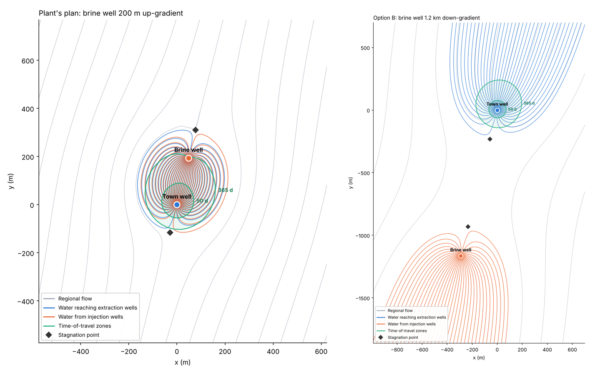
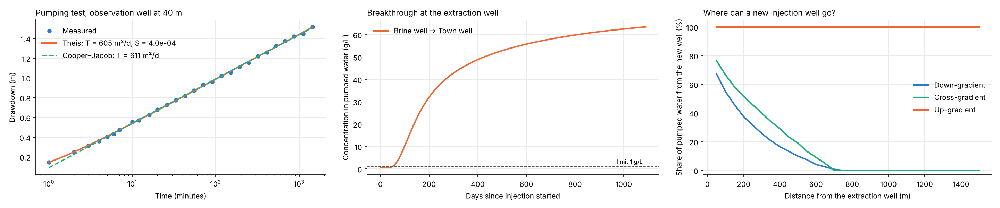

# wellfield

**Pumping tests, wellhead protection zones and injection-well screening for confined aquifers, in plain Python.**

Give it a pumping test, a few observation-well heads and a list of wells. It returns the aquifer's transmissivity and storativity, the regional flow, time-of-travel protection zones around supply wells, and whether (and when) water from an injection well reaches a supply well.



Typical uses: drinking-water protection zones (e.g. the 50-day zone), brine or wastewater injection wells, geothermal and ATES doublet spacing, managed aquifer recharge, quick checks of well interference.

## Install and run

```bash
pip install git+https://github.com/RisaRezaei/wellfield
wellfield examples/brine_case/plan.toml        # or: python -m wellfield config.toml
```

Outputs go to the folder named in the config: `report.md`, `results.json`, `zones.geojson` (opens in QGIS/ArcGIS) and figures.



## Your inputs

| File | Columns | Notes |
|---|---|---|
| pumping test | `time, drawdown` | drawdown in m; time unit set in the config |
| observation wells | `name, x, y, head` | ≥ 3 wells, projected coordinates in m |
| wells | `name, x, y, rate` | m³/day, **+ extraction, − injection** |

The config (TOML) says what to compute; see [`examples/brine_case/plan.toml`](examples/brine_case/plan.toml). Every section except `aquifer` and `wells` is optional; give `aquifer.transmissivity` directly if you have no pumping test, and `regional_flow.gradient` + `flow_azimuth` if you have no observation wells.

## Methods

| Step | Method |
|---|---|
| T and S | Theis fit by least squares (with 95 % ranges), checked by the Cooper–Jacob line on data with u < 0.05 |
| Regional flow | Plane h = Ax + By + C through the observation wells (least squares for > 3) |
| Flow field | Uniform flow + point sinks/sources (superposition), stagnation points by root finding |
| Zones and paths | 4th-order Runge–Kutta particle tracking, steps shortened near wells |
| Breakthrough | Ogata–Banks solution per streamtube, mixed at the well by flow; Crank–Nicolson solver as a check |

`pytest` runs the checks against textbook results: Theis W(u) table values, the radial isochrone area Qt/(nb), the stagnation point Q/(2πq₀), the catchment width Q/q₀, the doublet recirculation threshold 2Q/(πq₀), and Ogata–Banks against the finite-difference solution.

## Limits

Confined, homogeneous, isotropic aquifer; steady regional flow; fully penetrating wells; no boundaries (rivers, coastlines, faults); no density effects. For those, use a numerical model such as MODFLOW. These results are a first screening.

## Example

[`examples/brine_case`](examples/brine_case) is a fictional coastal site: should a desalination plant inject 1,500 m³/day of brine 200 m up-gradient of a town well pumping 1,500 m³/day? Result: all of the brine reaches the town well and the water exceeds 1 g/L after about 50 days; down-gradient it is safe from about 770 m. Write-up: [risarezaei.github.io/groundwater.html](https://risarezaei.github.io/groundwater.html).

## Author

Parisa Abbasalizadehrezaei · [risarezaei.github.io](https://risarezaei.github.io) · MIT licence

## Contributing

Bug reports, questions and pull requests are welcome through the Issues and Pull requests tabs.
